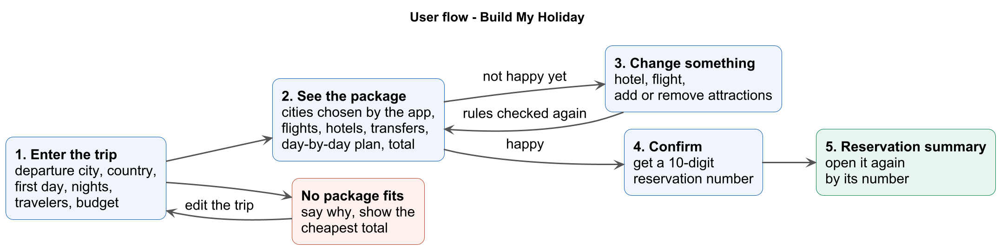

# Problem 1: Holiday Package → Build My Holiday

## At a glance

| Topic | In short |
|---|---|
| **The traveler gives** | Departure city, destination country, holiday start date, number of nights, adults, children's ages, budget |
| **Your app builds** | One complete holiday package: flights, hotels, airport transfers, transfers between cities, and attractions. **Your app chooses the cities.** |
| **The traveler can** | Change the hotel, change a flight, add or remove attractions |
| **At the end** | The traveler confirms and gets a **10-digit reservation number** that opens a summary of the package |
| **The event** | Teams of 2. About 9–10 hours to build. A 12-minute demo at the end. |

---

## 1. The traveler

A holiday abroad has many parts, and when one part changes, other parts often stop fitting. Build an app that puts the parts together correctly, keeps them correct after each change, and books the result.

The **Menon family** from Bengaluru (two adults, one child aged 6) wants their first holiday in Japan:

| Request | Value |
|---|---|
| Departure city | Bengaluru (BLR) |
| Destination country | Japan |
| Holiday start date | 10 April 2027 |
| Nights | 6 |
| Travelers | 2 adults, 1 child (age 6) |
| Budget | ₹3,50,000 for everything |

The **holiday start date** is the first day in the destination country: the arrival flight lands on that day. An overnight flight leaves India the evening before. The family flies home on the last day (16 April), with no hotel night that day.

---

## 2. What you build

A web application with a **backend** and a **frontend** that work together.

---

## 3. Inputs you receive

| File | What it is |
|---|---|
| `data/catalog/destinations.json` | Departure cities, destination countries (Japan, United Arab Emirates), their cities, and the transfers between cities |
| `data/catalog/airports.json` | Airports, time zones, and the cities each airport serves |
| `data/catalog/flights.json` | Flights between India and Japan or the UAE: local times, price per seat, seats left |
| `data/catalog/hotels.json`, `rooms.json`, `availability.json` | Hotels, room types (who fits, price per night), and rooms left per night |
| `data/catalog/transfers.json` | Airport taxis and buses, transfers between cities, and city taxis |
| `data/catalog/attractions.json` | Attractions: opening days and hours, closed dates, visit time, prices |
| `images/` | Photos. If you show them, also show the credits in `images/ATTRIBUTIONS.md`. |

`DATA_DICTIONARY.md` explains every field. Flights and rooms exist from **1 to 20 April 2027** only.

---

## 4. Travel rules

A package is correct only if every rule is true. Judges check every rule.

**Dates and cities**

- The trip is 3 to 10 nights. The first night is on or after 1 April 2027, and the return flight is on or before 20 April 2027.
- All cities are in the chosen country. Your app chooses the cities, their order, and the nights in each.
- Each city has at least 2 nights in a row, and appears once in the plan.

**Flights**

- One arrival flight from the departure city and one return flight to it.
- The arrival flight lands on the holiday start date (local time) at an airport that serves the first city (`serves_cities`).
- The return flight leaves on the last day (local time) from an airport that serves the last city.
- Every traveler, including each child, needs a seat: `seats_left` ≥ travelers.

**Airport transfers**

- One transfer from the arrival airport to the first hotel, and one from the last hotel to the return airport. The transfer serves the hotel's city and area.
- The pickup is at least 60 minutes after landing.
- The traveler reaches the airport at least 180 minutes before departure.
- The pickup time, and the time to leave the hotel, are inside the service hours.

**Transfers between cities**

- On each day the traveler moves to the next city, one transfer from the old city to the new city (`from_city`, `to_city`), inside its service hours. City taxis to and from stations are optional.

**Hotels**

- One hotel for every night. No hotel night on the last day.
- In each city, one hotel and one room type for all nights. Several rooms of that type are fine.
- `k` rooms fit the travelers if adults ≤ k × `max_adults`, adults + children ≤ k × (`max_adults` + `max_children`), and adults ≥ k.
- `rooms_left` ≥ `k` on every night of the stay.

**Attractions**

- An attraction is in the city of that night's hotel, is open that day, and the visit fits inside the opening hours.
- Visits on the same day do not overlap. Each attraction is in the package at most once.
- The first package has 1–2 attractions on every full day.
- On the arrival day and on a city-change day, attractions are optional and start after the traveler reaches the city. No attractions on the last day.

**Prices**

| Part | Price |
|---|---|
| Flight | `price_per_seat` × travelers |
| Hotel | `price_per_night` × rooms × nights |
| Transfer, `PER_PERSON` | adults × `price` + children × `child_price` (or `price` if there is none) |
| Transfer, `PER_VEHICLE` | `price` × vehicles, where vehicles = travelers ÷ `max_passengers`, rounded up |
| Attraction | adults × `price_per_person` + children × `child_price` (or `price_per_person` if there is none) |

- All prices in the data are INR. The total is the sum of all parts.
- A child is anyone aged 0 to 17. Judges accept up to 1% difference per price from rounding.

---

## 5. Features

The Must-have features are your priority. A single correct package that passes all rules is better than three broken packages. Good-to-have and Stretch features earn extra credit only after all Must features work correctly. Budget your time accordingly.

### Must have

| # | Feature | Done when |
|---|---|---|
| M1 | **Request form** | The form has the 7 request fields. Departure cities and countries come from `destinations.json`. A value that is not valid shows a clear message. |
| M2 | **Build one package** | The app chooses the city plan and builds a complete package. When no package is possible, the app says so and says why. |
| M3 | **Rules are respected** | Every rule in section 4 is true for the package. |
| M4 | **Day-by-day plan** | The package shows each day in time order: flights, transfers, hotels, and attractions. |
| M5 | **Total and budget** | The app shows the total in INR, the budget, and the amount left or over. The package can be exported as JSON (section 6). |
| M6 | **Change the package** | The traveler can change the system selected hotel in a city, change a flight, and add or remove attractions. The app checks the whole package again and updates the total, or refuses the change with a reason. |
| M7 | **Confirm and reservation summary** | Confirm gives a unique 10-digit reservation number. The number opens a summary of the whole package, also after a backend restart. A wrong number shows "not found". |
| M8 | **Budget too small** | When no package fits the budget, the app says so, shows the cheapest total, and suggests a change. |

### Good to have

| # | Feature | Done when |
|---|---|---|
| G1 | **Changes that affect other parts** | After a change, the app fixes or warns about the other booking it affects. Example: Attractions must not have conflicting times or double bookings or a flight change should pop up about the accommodation check in times. |
| G2 | **Price difference** | Each change option shows the difference against the current choice. |
| G3 | **Change cities** | The traveler can choose another valid city plan, and the app builds the package again. |
| G4 | **Three packages** | The app offers the **cheapest** (lowest total price), the **fastest** (least total travel time: sum of flight durations + all transfer durations between cities), and the **best rated** (highest average hotel `stars` per night, within budget; the guest `rating` does not count). On a tie, show either one. The traveler picks one. |

### Stretch

| # | Feature | Done when |
|---|---|---|
| S1 | **Quick request** | The traveler types a short request in plain words. Your code reads it with rules (no AI) and fills the form. |
| S2 | **Booking uses up seats and rooms** | A confirmed reservation reduces seats and rooms in your app's own store. A booking that needs the same last seats or rooms is refused. |
| S3 | **Your own idea** | Any other feature that makes the holiday easier to plan or book. |

---

## 6. Package export (JSON file)

Your app downloads the package as one JSON file. During the demo, the judges load it into a tool that checks every rule in section 4.

Use the **shared trip format** in `DATA_DICTIONARY.md`, section 4. `data/trip_format_example.json` is a short example. For this problem, also set `country`, and give hotel items a `room_id`. After confirm, set `status` to `BOOKED` and `booking.reference` to the reservation number as a string.

---

## 7. Technical rules

| Rule | Detail |
|---|---|
| Any stack | Any language, framework, and database |
| Catalog only | Every flight, hotel, transfer, attraction, price, and opening time comes from `data/catalog/`. Do not change the data files. |
| Backend holds the logic | Choosing cities, building the package, rule checks, and prices run in the backend. The frontend gets all data from your backend API. |
| State is saved | Packages and reservations survive a page refresh and a backend restart. |
| No AI inside the app | Your app must not call an AI or LLM model (cloud or local). AI tools to help you write code are allowed. |
| Start in 1–2 commands | Write the commands in your README. |
| Build during the event | Templates and open-source libraries are allowed. Feature code is written during the event. We check the Git history. |

---

## 8. How we judge

| Area | Weight |
|---|---|
| Working end-to-end feature (Must / Good / Stretch reached) | 25% |
| Correctness on new requests and changes given by the judges | 25% |
| Individual understanding (questions to each member, one small live code change) | 20% |
| Product and user experience | 15% |
| Engineering quality (code structure, data model, README, Git history) | 15% |

The judges enter **requests you have not seen**: other departure cities, the other country, other dates, travelers, and budgets. There is no single correct package. A package that breaks one rule is wrong, even if it looks good.

| The request has... | Your app must... |
|---|---|
| A package within budget | Build a correct package |
| Packages, but none within budget | Say so (M8) |
| No possible package | Say so, with the reason (M2) |
| A value that is not valid | Show a clear message (M1) |

---

## 9. Demo and submission

**Demo (12 minutes):** 4 minutes live demo with the Menon request (build, change, confirm, open the reservation), 3 minutes of judge requests, 4 minutes of questions, 1 minute changeover. Before your slot: app running, form empty.

**Submission:**

1. Push your code to your Git repository every hour.
2. At code freeze, upload a zip file to HackerEarth with your source code, `README.md`, and setup scripts. No `node_modules`, virtual environments, build output, or API keys.
3. The `README.md` says how to start the app, the architecture, your city rule, what you finished, and known limitations.

---

## 10. FAQ

**Can we use AI tools to write code?** Yes. You must understand and explain all your code.

**Is "confirm" a real booking?** No. Confirm saves the reservation in your app. There is no payment, and the data files do not change.

**Must the package be the cheapest?** No. It must be correct, and within budget when possible.

**Do we need user login or payments?** No.

**Must we deploy the app online?** No. It runs on your laptop for the demo.

**Can the arrival and return airports be different?** Yes, if each airport serves the right city.

**Are one-stop flights allowed?** Yes.

**Can the app show more than one package?** Yes. The traveler picks one.

**Do judges check hotel check-in and check-out times?** No. They are for display only.

**Do we need city taxis on a city-change day?** No. If you add them, add their price.

**Can we change the data files?** No. Judges use the original files.

**Where do we ask questions?** At the help desk or in the event chat channel. We send every answer to all teams.
